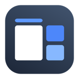
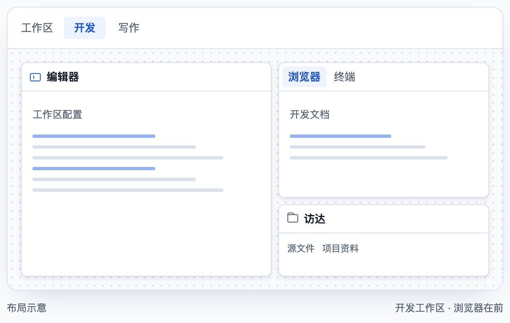

# workstack

**按项目整理 Mac 上已经打开的窗口。** 把编辑器放在左侧，浏览器和终端叠成右侧的标签，保存成一个工作区。下次回到项目，单击侧栏就能恢复这套布局，继续在原来的应用里输入。

[项目主页与交互演示](https://zhong0118.github.io/workstack/) · [从源码构建](#从源码构建) · [实机验证](Docs/Verification.md)

[](https://zhong0118.github.io/workstack/)

## 组建第一个工作区

1. 在侧栏新建工作区，例如「开发」。打开「所有窗口」→「新建窗口组」，勾选已经打开的窗口。同一应用的两个独立窗口也可以分别选择。
2. 输入组名，选择工作区和布局，检查预览后点「创建并应用」。在编辑器中，把窗口拖到窗格中央会加入标签组，拖到边缘会创建分屏。也可以先创建空组，再关联窗口。
3. 回到这个项目时，点侧栏的工作区名称，或按 **Control + Option + 空格** 搜索工作区、窗口和命令。只想查看或修改结构时，点卡片上的「编辑布局」。

| 设置 → 工作区 | 切换效果 |
| --- | --- |
| 聚焦 | 将相关窗口前置，保留它们当前的大小和位置。 |
| 排布（默认） | 将窗口恢复到保存的分屏、浮窗位置和目标显示器，最后聚焦一个窗口。 |
| 专注 | 排布当前工作区，并尝试最小化上一个工作区中可安全恢复的窗口。需手动启用。 |

同一工作区可以包含多个组。组内支持跨应用标签、左右或上下分屏、三列、主窗加堆叠、网格和自由浮动。布局模板可以复用；复制工作区会复制结构，为新项目保留空位。

## 从源码构建

需要 Swift 6 和 macOS SDK。应用部署目标为 macOS 14 或更高版本；本机系统交互验证使用 Apple Silicon、macOS 27.0.1。仓库采用 Swift Package Manager，界面使用 SwiftUI 和 AppKit。

在具备仓库读取权限的终端运行：

```sh
git clone https://github.com/Zhong0118/workstack.git
cd workstack
Scripts/package.sh release --output dist/local-preview
open dist/local-preview/workstack.app
```

脚本会创建本地签名的应用。如果输出目录已包含同名应用，请换一个新目录。首次启动时，按引导在「系统设置 → 隐私与安全性 → 辅助功能」中允许 workstack。重新构建后，系统可能要求再次授权。

## 权限与恢复

- **辅助功能**用于发现窗口、调整位置与尺寸、切换焦点。窗口预览默认关闭；点开预览才需要单独的屏幕录制权限。使用图标和布局示意即可完成核心操作。
- **标签切换**默认把同一窗格的标签叠放在同一位置，切换时只前置目标窗口。在「设置 → 窗口组」开启最小化后，后台标签会收进程序坞；这取决于应用能力和可核对的窗口身份，无法安全恢复的标签仍保持叠放。用户手动最小化的窗口保持原状。
- **窗口失联**时保留布局占位。在检查器里选择「重新关联窗口」，从同一应用的现有窗口中匹配。应用退出后，可明确确认启动，再重新关联。
- **配置和恢复日志**保存在本机 `~/Library/Application Support/WindowWorkbench/`，沿用早期版本的路径。正常退出会尽可能还原受管窗口；异常退出后可在「设置 → 权限与隐私」执行恢复。系统 Spaces、台前调度、全屏和固定尺寸窗口的行为仍受 macOS 与目标应用约束。

## 开发与验证

```sh
swift build
Scripts/test.sh
Scripts/lint.sh
```

独立探针 `swift run window-probe` 默认只读。在允许测试窗口短暂获得焦点的图形桌面上，可运行 `Scripts/integration-check.sh release`。脚本会在临时目录构建 QA 应用，用两个专用测试应用的四个窗口验证标签切换、分组、撤销和退出恢复。

[架构与设计](Docs/Design.md) · [自动化验证记录](Docs/Verification.md) · [GUI 与探针性能测量](Docs/Performance.md) · [真实应用验收清单](Docs/ManualAcceptance.md)
